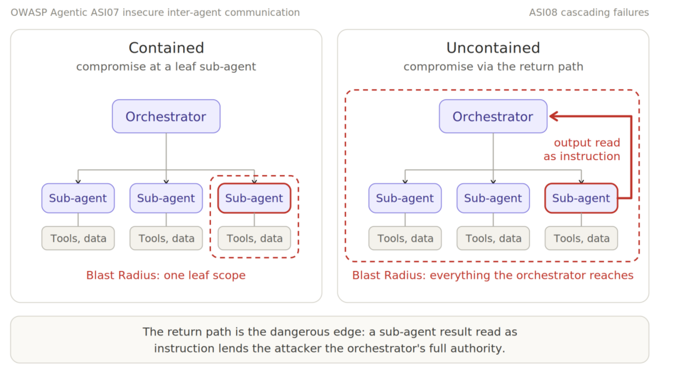

## フェーズ 6: 悪用後

### 主な目標（objective）

悪用後と影響の評価フェーズは、攻撃または永続化イベントが成功したことが確認された後に開始されます。このフェーズの目的は、侵害の結果を評価し、攻撃者がどの程度のアクセス権限または影響力を獲得したかを特定し、技術的および組織的な影響を判断することです。このフェーズは、さらなる攻撃ではなく、分析と検証に重点を置いており、侵害の範囲と深刻度を判断するために使用する必要があります。

### 主要な目的（goal）

- 侵害の範囲と深刻度を特定します。
- 攻撃者の有効な権限と機能を特定します。
- ビジネス、安全性、セキュリティへの影響を評価します。
- アクセスまたは操作される可能性のあるデータや機能を検証します。
- ラテラル ムーブメント（水平移動）や連鎖的な障害の可能性を特定します。
- エクスプロイトが永続的またはシステム的な問題を引き起こすかどうかを検証します。
- 調査結果を実用的な洞察と対策の優先順位に変換します。

### 重要となる活動

### 6.1 攻撃者の能力とアクセス権の特定

攻撃者がアクセス権を取得した後に何ができるかを評価します。影響の例としては、以下のようなものがあります。

- メモリや RAG 汚染による将来のモデル出力への影響
- 不正なツールや API の実行のトリガー
- 意図されたユーザー権限を超えた情報へのアクセス
- モデル出力に依存する業務ワークフローの操作
- 安全性対策やポリシー適用の継続的な回避

取得できる能力とその再現性を明確に文書化します。

### 6.2 影響範囲の把握

侵害によって影響を受けるすべてのシステム、データ、ユーザーを特定します。評価対象領域は以下のとおりです。

- ユーザーへの影響
- システムおよびワークフローへの影響
- データの意図せぬ公開または改変
- 整合性（アライメント）および安全性の低下
- 規制または法的リスク
- 組織または顧客への影響

概要には、機密性、完全性、可用性、安全性への影響、および悪用による影響の拡大について記載する必要があります。

上記の項目は、影響を受けた対象者と対象物を明確にします。セクション 6.5 のスコアリング項目に反映させるため、以下の固定軸に影響範囲を記録します。これにより、独立したテスターは評価の根拠を共通して説明できますが、必ずしも同一の判断が得られるとは限りません。これらのスコアは、調整された深刻度評価を表すものであり、数値尺度や数学的な最大値または平均値ではありません。

- アクション クラス: 読み取り専用、可逆、外部可逆または不可逆。影響を元に戻せるかどうか、また誰が元に戻せるか。
- チェーンの深さ: 単一ステップ、限定されたチェーン、または無制限の自律チェーン。再認可なしで侵害によって発生する可能性のある複合呼び出しの数。
- 外部到達性: 内部のみ、パートナーまたは第三者、または公開。影響が信頼関係や組織の境界を越えるかどうか。
- 可逆期間：即時アンドゥ、帯域外アンドゥ、またはなし。被害が確定する前に元に戻すための時間と労力。
- アイデンティティの範囲: 限定された人間、共有された人間、または非人間の資格情報。誰の権限でアクションが実行されたか。

各軸を個別に記述し、明確に実証された到達可能な経路によって裏付けられた、最も重大な影響を評価します。前提条件を明記し、観測された影響と潜在的なエスカレーションを区別します。不可逆的な結果を平均化したり、異なる軸のスコアを互換性のあるものとして扱ったりしてはなりません。複合チェーンの場合、残りの承認ゲートに関する明示的な仮定を添えて、最も深刻な到達可能な結果を重大度の下限値として使用します。

CVSS スコープの変更に関する文書化された例は、いくつかのオーケストレーション フレームワークで利用可能です<sup>[22][21][24][25]</sup>。4 つのフレームワーク固有の論文にはそれぞれ、GenAI Red Team Lab にハンズオン ラボが用意されています。Semantic Kernel<sup>[26][27][28]</sup>、LlamaIndex<sup>[29][30][31]</sup>、LangChain<sup>[32][33][34]</sup>、Haystack<sup>[35][36][37]</sup> です。

#### 6.2.1 オーケストレーション型およびサブエージェント型アーキテクチャにおける影響範囲

プライマリ エージェントがサブ エージェントに処理を委任する場合（セクション 4.5.3 の攻撃テストを参照）、末端ノードの侵害は、共有ストレージや外向きチャネルなど、そのサブ エージェントの権限と到達可能なリソースによって初期段階では制限されます。影響範囲が拡大する要因の一つとして、リターン パスが挙げられます。オーケストレーターがサブ エージェントの出力を命令として読み取る場合、攻撃者はオーケストレーターのより広範な権限を継承することになります。セクション 6.2 の軸に以下の項目を追加します。

- 末端ノードにおける封じ込め: 侵害は 1 つのサブ エージェントに限定されたのか、それともオーケストレーターにまで及んだのか？
- リターン パスの信頼性: オーケストレーターはサブ エージェントの出力をデータとして扱うのか、それとも命令として扱うのか？
- 権限の集約: 連鎖するサブ エージェントは、単一のエージェントでは到達できないデータやアクションに到達できるのか？
- 連鎖的影響の可能性: エージェント間で伝播するのか？（セクション 5.3.3 のエージェント間伝播のテストを参照）

OWASP Agentic ASI07 Inter-Agent Communication、ASI08 Cascading Failures、および ASI10 Rogue Agents<sup>[10]</sup> に対応します。

<div align="center">



</div>

### 6.3 侵害の永続化と安定性の検証

永続化の検証結果を得るには、レッド チームは、エクスプロイトが一時的な単発の異常ではなく、通常の運用条件下でも有効であり続けることを証明する必要があります。

検証結果は、次の 3 つの主要な側面に基づいて評価し、報告します。**残存性**（どの境界リセット後も残存しますか？）、**影響範囲**（誰が影響を受けますか？）、および**キャリア**（どこに存在しますか？）。

*（注: ストレージ内に休止状態で存在するペイロードは、単なるデータ残骸です。永続化は、クリーンな後続セッションがペイロードを正常に呼び出し、実行した場合にのみ確立されます。）*

- **1. 残存性（攻撃は継続するか？）**

	攻撃がセッション リセットにより残存しない場合、**永続化は達成されません**（単一ターン攻撃または一時的なインジェクションとして分類します）。永続化が達成された場合は、ペイロードがどの境界イベントとメンテナンス サイクルを生き延びたかを記録します。
	- **セッション リセット**: チャットの終了および同一アイデンティティでの新規セッションの初期化でも残存します。
	- **サービス再起動**: コンテナの再起動、ワーカーのリサイクル、またはアプリケーションの再起動でも残存します。
	- **パイプライン メンテナンス**: キャッシュのフラッシュ、インデックスの再構築、または文書の再同期でも残存します。
- **2. 影響範囲（誰が影響を受けるか？）**

	理論上のリスクではなく、実際に検証したアカウントに基づいて影響範囲を分類します。
	- **ローカル（単一ユーザー）**: 攻撃者自身のアカウントでの今後のセッションでのみ発生します（例: ユーザー設定やプロファイル メモリの汚染）。
	- **水平方向（ユーザー間/同一テナント）**: 同一組織内の他の正当なユーザーに影響を及ぼします（例: 共有 RAG 文書の汚染、チーム チケットの汚染）。
	- **システム的（テナント間/複数システム）**: テナント境界を越えて他の組織に侵入したり、下流の接続されたエージェントに伝播したりします（例: 自己複製ワーム、共有基盤インデックス）。
- **3. キャリア（どこに存在しますか？）**

	ペイロードを格納している状態ストアの正確な場所を文書化します。
	- 会話/ユーザー メモリ
	- RAG/ベクトル データベース
	- ビジネス アプリケーション データ（CRM リード、チケット、電子メール）
	- フレームワーク初期化ファイルまたはローカル ディスク キャッシュ

#### 報告形式

「中程度の永続化」のような曖昧な表現は避け、代わりに、検証済みのチェーンを結果概要に直接記載します。

- **例**: ```永続化: 確認済み（コンテナの再起動後も残存；同一テナント内でのユーザー間接続の範囲；キャリア: 共有 RAG ベクトル ストア）。テナント間接続: 未検証。```

#### 6.3.1 残存 AI 状態の検証のためのテスト方法


