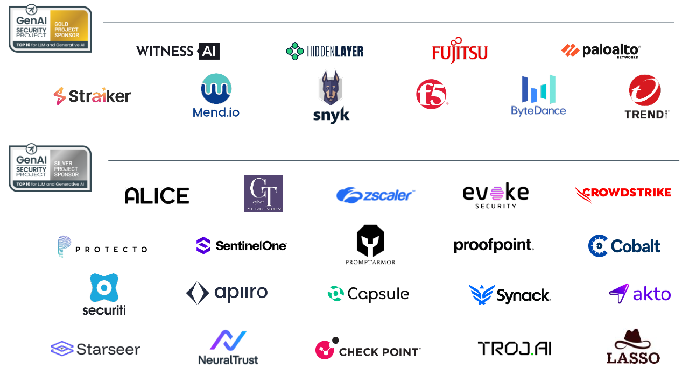

# OWASP 生成 AI セキュリティ プロジェクトのスポンサー

プロジェクト スポンサーの皆様には、プロジェクトの目標達成を支援し、運営費や広報活動費を賄うための資金提供にご協力いただき、心より感謝申し上げます。これらの資金は、OWASP.org 財団から提供されるリソースを補完するものです。OWASP 生成 AI セキュリティプロジェクトは、引き続きベンダー中立かつ公平なアプローチを維持しています。スポンサーの皆様には、ご支援の見返りとして特別なガバナンス上の優遇措置は提供しておりません。

スポンサーの皆様には、プロジェクト資料およびウェブサイトにおいて、ご貢献いただいた内容を掲載させていただきます。プロジェクトで作成されるすべての資料は、コミュニティ主導で開発・公開され、オープンソースおよびクリエイティブ コモンズ ライセンスに基づいて提供されています。スポンサーシップに関する詳細は、ウェブサイトのスポンサーシップ セクションを参照してください。スポンサーシップを通じてプロジェクトを支援する方法について、詳しくご紹介しています。

## プロジェクトのスポンサー

	

**本書公開日時点のスポンサー一覧です。スポンサー一覧の全文は[こちら](https://genai.owasp.org/supporters/)を参照してください。**
